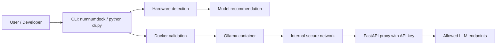

# NumNumDock

<div align="center">
  
  <h1>🚀 NumNumDock</h1>
  <p><b>Run local LLMs securely, quickly, and privately with Docker.</b></p>
</div>

NumNumDock helps you run open-source large language models locally in Docker with a safer setup than exposing a model directly on your machine. It checks your hardware, recommends a model, validates Docker, launches the model in a container, and exposes a local API proxy with a generated API key.

This project is intended for developers, AI hobbyists, and privacy-conscious users who want to self-host models without making them publicly reachable.

> [!NOTE]
> NumNumDock is designed around local-first AI workflows. It focuses on private, self-hosted model deployment rather than remote cloud hosting.

## Quick navigation

| Section | Link |
| --- | --- |
| Start | [Quick Start](#quick-start) |
| Learn | [Why this project?](#why-this-project) |
| Features | [Key Features](#key-features) |
| Docs | [How it works](#how-it-works) |
| Support | [Contributing](#contributing) |

## Why this project?

Local AI can be hard to set up. You need Docker, enough resources, a model choice, and a safe way to access the model without exposing it carelessly.

NumNumDock simplifies the process by combining deployment, isolation, and verification into one local workflow.

| Pain point | How NumNumDock helps |
| --- | --- |
| Docker and model setup is confusing | Validates Docker availability and starts the containerized flow |
| Hardware varies by machine | Detects basic hardware and recommends a model |
| Public exposure is risky | Creates an internal Docker network and isolates the model |
| Local debugging is hard | Provides `status` and `doctor` checks for quick diagnosis |
| Model access should be controlled | Protects the proxy with a generated API key |

## Key Features

| Feature | Description |
| --- | --- |
| 🧠 Hardware-aware model selection | Checks machine basics and recommends a suitable model |
| 🐳 Docker-first deployment | Runs the model inside Docker for a more controlled setup |
| 🔒 Secure isolation | Builds an internal Docker network to reduce direct exposure |
| 🔐 Protected local API | Generates a random API key and validates bearer-token access |
| 🧭 Restricted endpoints | Only allows a small, explicit set of model endpoints |
| 🩺 Health checks | Includes `status` and `doctor` commands for quick troubleshooting |
| ⚡ Local-first workflow | Keeps the focus on private, self-hosted inference |

## How it works



The project follows this flow:

1. The CLI checks whether Docker is available.
2. It inspects hardware to decide which model to use.
3. It launches the Ollama container through Docker.
4. The model is pulled into the container’s data volume.
5. The container is moved to an internal network for isolation.
6. A local proxy validates API-key access and forwards only approved endpoints.

## Quick Start

### 1) Install

Install from PyPI:

```bash
pip install numnumdock
```

Or install from source:

```bash
git clone https://github.com/uzankhan/NumNumDock.git
cd NumNumDock
python -m pip install -r requirements.txt
```

### 2) Start the app

Use the installed package entrypoint:

```bash
numnumdock start
```

Or launch from the repository source directly:

```bash
python cli.py run
```

You can also choose a model explicitly:

```bash
numnumdock run llama3.2:1b
```

### 3) Check status

```bash
numnumdock status
```

### 4) Run diagnostics

```bash
numnumdock doctor
```

> [!TIP]
> If Docker is not running, the project will stop early and ask you to start Docker before proceeding.

## Detailed installation

### Local install

| Requirement | Value |
| --- | --- |
| Python | >= 3.9 |
| Docker | Required |
| Package manager | pip |
| OS | Systems with Docker support |

```bash
python -m pip install --upgrade pip
pip install numnumdock
```

### Source install

```bash
git clone https://github.com/uzankhan/NumNumDock.git
cd NumNumDock
python -m pip install -r requirements.txt
```

### Run from source

```bash
python cli.py run
python cli.py status
python cli.py doctor
```

## Configuration

NumNumDock does not currently include a large environment configuration file. The important runtime dependency is Docker being available and healthy.

| Variable / Setting | Required | Default | Description |
| --- | --- | --- | --- |
| Docker daemon | Yes | None | Must be running for deployment to work |
| Model name | No | Recommended by hardware | Example: `llama3.2:1b` or `llama3.1:8b` |
| Proxy API key | Auto-generated | Random `sk-numnum-...` value | Protects local access to the model proxy |
| Host bind | Local-only | `127.0.0.1` | The proxy binds to the local machine |

> [!WARNING]
> Keep the generated API key private. Do not paste it into public chats, screenshots, or logs.

## Usage examples

### Deploy with automatic recommendation

```bash
numnumdock start
```

This does the following:
- checks hardware
- recommends a model
- verifies Docker
- starts the Ollama container
- creates a local secure proxy

### Deploy with a specific model

```bash
numnumdock run llama3.2:1b
```

### Inspect the running state

```bash
numnumdock status
```

### Run the built-in health check

```bash
numnumdock doctor
```

## Project structure

```text
NumNumDock/
├── README.md                 # Project overview and usage documentation
├── README.old.md             # Backup of the previous README
├── cli.py                    # Typer CLI entrypoint
├── requirements.txt          # Python dependencies
├── project.toml              # Package metadata for the project
├── .gitignore                # Ignore local project artifacts
├── core/                     # Core logic for hardware, Docker, proxy, and security
│   ├── docker_manager.py     # Docker orchestration and model deployment
│   ├── hardware.py           # Hardware detection and model recommendation
│   ├── proxy.py              # Local API proxy logic
│   ├── security.py           # API key generation and secret redaction
│   └── native_manager.py     # Native runtime support code
├── proxy/                    # Proxy-related assets
│   └── Caddyfile             # Placeholder reverse-proxy config
└── assets/                   # Placeholder for project visuals
```

## Tech stack

| Layer | Technology |
| --- | --- |
| CLI | Python + Typer |
| Terminal UI | Rich |
| Container runtime | Docker |
| LLM runtime | Ollama |
| API layer | FastAPI + Uvicorn |
| HTTP client | HTTPX |
| Package metadata | `project.toml` |
| Runtime compatibility | Python >= 3.9 |

## CLI reference

The project currently exposes its core functionality through the Typer app and package entrypoint.

| Command | What it does |
| --- | --- |
| `numnumdock start` | Starts the secure deployment flow |
| `numnumdock run [MODEL]` | Deploys a model locally |
| `numnumdock status` | Checks Docker and running container state |
| `numnumdock doctor` | Runs the built-in health check |
| `python cli.py run` | Source-run equivalent |
| `python cli.py status` | Source-run status check |
| `python cli.py doctor` | Source-run diagnostics |

> [!NOTE]
> The checked-in repository code defines `run`, `status`, and `doctor`. If your published package exposes `start` as a wrapper, it is intended to point to the same deployment flow.

## Testing & quality

This repository snapshot does not show a dedicated automated test suite or CI workflow, so the project is best validated by running the CLI manually in a real Docker environment.

Recommended checks:

```bash
python cli.py doctor
python cli.py status
python cli.py run llama3.2:1b
```

For quality assurance, check that:
- Docker is installed and running
- Model pulls are allowed in your environment
- Local firewall or network settings do not block the host bind
- The generated API key is kept private

## Why NumNumDock matters

NumNumDock is useful when you want:
- a local LLM without public exposure
- a simple deployment path for open-source models
- a safer local AI workflow for experimentation
- a better privacy story than remote cloud-only usage

It is not a full production orchestration platform. It is a focused local deployment helper for private LLM usage.

## FAQ & Troubleshooting

<details>
<summary><b>Docker is not running</b></summary>

Start Docker Desktop or the Docker service, then run the command again.

```bash
numnumdock doctor
numnumdock status
```

</details>

<details>
<summary><b>No model is selected automatically</b></summary>

The project tries to recommend a model based on basic hardware detection. If the environment is limited, it falls back to a smaller model choice.

```bash
numnumdock start
```

</details>

<details>
<summary><b>I see unauthorized errors</b></summary>

The proxy validates a bearer token before forwarding traffic. Keep the generated API key and pass it in the `Authorization` header.

```bash
curl -H "Authorization: Bearer YOUR_API_KEY" http://127.0.0.1:PORT/api/chat
```

</details>

<details>
<summary><b>Which endpoints are allowed?</b></summary>

The current proxy allows a restricted list:

- `api/chat`
- `api/generate`
- `v1/chat/completions`

This keeps the exposure surface smaller and more controlled.

</details>

<details>
<summary><b>How do I keep the app running?</b></summary>

The proxy runs in the foreground while the deployment is active. Keep the terminal open and stop it with `Ctrl+C` when finished.

</details>

## Contributing

Contributions are welcome. If you want to improve NumNumDock, the best path is:

1. Fork the repository
2. Create a feature branch
3. Make your changes
4. Validate locally with Docker and the CLI
5. Open a pull request with a clear explanation

If you are improving packaging, docs, Docker automation, or security, that is especially valuable.

## Docs index

- [README.md](README.md)
- [cli.py](cli.py)
- [core/docker_manager.py](core/docker_manager.py)
- [core/hardware.py](core/hardware.py)
- [core/proxy.py](core/proxy.py)
- [core/security.py](core/security.py)

## Acknowledgments

This project builds on:
- Python packaging and CLI tooling
- Docker-based local ML deployment patterns
- Ollama-style model workflows
- FastAPI-based local API proxies

## License

The repository snapshot provided here does not include a visible `LICENSE` file, so the repo’s legal license is not verifiable from the checked-in files alone.

<!-- TODO: Add the project LICENSE file and link it here once the license is chosen. -->

## Contact / Support

For questions, issues, or collaboration:

- GitHub: https://github.com/uzankhan/NumNumDock
- Open an issue or pull request in the repository
- Share feedback about packaging, docs, security, or Docker workflows

---

<div align="center">
  <p><b>Built for local AI experimentation, privacy, and developer control.</b></p>
  <p>NumNumDock is open to collaboration and continuous improvement.</p>
  <p><a href="#top">Back to top</a></p>
</div>

<!-- TODO: Add a real project logo and CLI screenshot for a more polished landing page. -->
